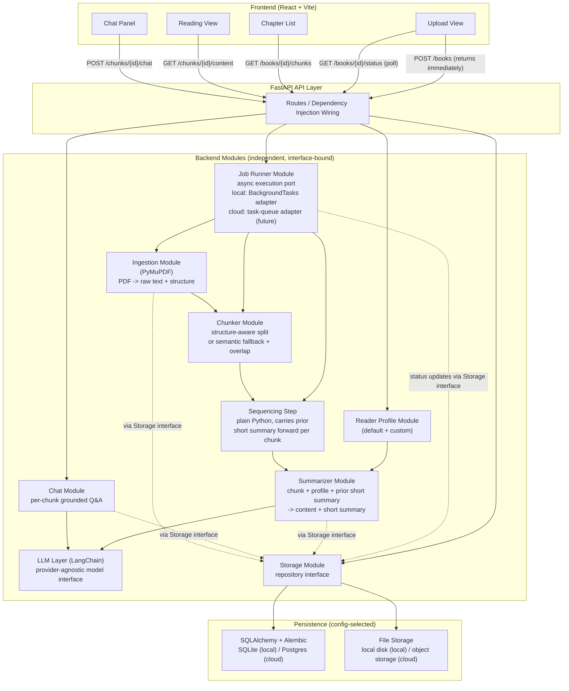

# Minify — Design Document

## 1. Overview

Minify is a tool that ingests long-form written content — starting with PDFs of books, but generalizable to anything with chapters or logical sections — and turns it into something more consumable and interactive. It breaks a book down into its logical sections, generates tailored content for each section based on who is reading it and why, and lets the reader have a conversation with any individual section.

The app is initially built to run entirely on a local machine (localhost), with no assumption baked in that it must stay that way. It should be straightforward, later, to point the same codebase at a cloud deployment without rewriting anything — that requirement shapes almost every design decision below.

## 2. Problem Statement

Readers frequently run into books or long documents that are:

- **Too large or dense** to get through, even when the underlying ideas are valuable — leading to abandoned books and unread PDFs.
- **Not tailored** to the reader's actual background or intent. A single generic summary rarely serves a beginner and an expert equally well, or serves someone reading for exam prep the same way it serves someone reading for casual interest.
- **Passive.** Once you have a summary, there's nowhere to go if you have a question about a specific idea in a specific chapter — you either re-read the source or give up on the question.

Minify addresses all three: it shortens without flattening, tailors the output to the reader, and makes each section interactive.

## 3. Goals

1. **Ingest** a PDF (or similar chaptered document) and reliably extract its text and structure.
2. **Personalize** — capture a reader profile (with a sensible default) that shapes how detailed, technical, or example-driven each chunk's content is.
3. **Segment intelligently** — split the book into logical chunks along chapter boundaries when they exist, and fall back to a sensible semantic/length-based split (with overlap, to preserve context across chunk boundaries) when they don't.
4. **Generate tailored content** per chunk — detailed enough to serve the reader's stated profile and the book's apparent intent, plus a separate short summary used only for continuity between chunks. The short summary is also shaped by the reader profile (it should still reflect what this reader is looking for in the chunk), but stays leaner than the content — it can skip things like worked examples or extended elaboration that the content needs but continuity doesn't.
5. **Preserve narrative coherence** — later chunks' content should read consistently with earlier ones, as though the whole book was considered as a whole, not as ten disconnected write-ups.
6. **Enable interaction** — every chunk has its own chat interface, so a reader can ask questions grounded in that specific section's content.
7. **Stay modular** — every part of the system (ingestion, chunking, summarization, chat, storage, LLM access, UI) must be independently replaceable. Nothing should assume a specific model, a specific database, a specific hosting environment, or a specific UI framework. Changing one part should never require touching another.
8. **Stay deployment-agnostic** — the app must run unmodified on a laptop via localhost today, and be deployable to a cloud provider later via configuration changes only, never code changes.

## 4. Architectural Principles

- **Ports and adapters (hexagonal architecture).** Every module exposes a narrow interface. Other modules depend only on that interface, never on its internal implementation. Concrete implementations ("adapters") are plugged in at one central wiring point.
- **Config over code branching.** Anything that differs between local and cloud, or between one LLM provider and another, is a configuration value (read via environment variables / `.env`), never an `if environment == "local"` style branch in application code.
- **Shared data contracts, not shared logic.** Modules agree on the *shape* of data passed between them (via typed models) and nothing else. This is what allows, for example, the summarizer to be rebuilt from scratch without the chat module noticing.
- **Frontend/backend separation.** The UI is a fully separate application that only ever talks to the backend over a REST/JSON API. It carries no business logic and has no shared code with the backend, so either side can change independently.
- **Defer what isn't needed yet.** Capabilities like a vector store are deliberately left out of the current design rather than half-built in. The storage layer is structured so such additions later are additive, not disruptive — but they are not part of the current build.

## 5. Tech Stack

| Layer | Choice | Why |
|---|---|---|
| Backend framework | **FastAPI** | Thin HTTP/orchestration layer; keeps business logic in modules, not routes |
| LLM abstraction | **LangChain** | Provider-agnostic chat model interface — swapping between Claude, OpenAI, or a local model becomes a config change |
| Database | **SQLAlchemy + Alembic**, running on **SQLite** locally | SQLite is a single file, no server process, zero setup — ideal for a laptop-only app. SQLAlchemy means the same models/queries work unchanged if the connection string later points to a server-based database (e.g. Postgres on a cloud provider) |
| PDF parsing | **PyMuPDF** | Extracts text plus font/heading metadata, used to detect chapter structure |
| File storage | Simple internal interface, local-disk adapter | Swappable later for cloud object storage without touching callers |
| Background job execution | Simple internal interface; **FastAPI `BackgroundTasks`** adapter locally | Ingestion/chunking/summarization runs after the upload response is sent, not inline — swappable later for a real task queue (e.g. Celery, RQ, cloud tasks) without touching callers, same ports-and-adapters pattern as storage |
| Configuration | **Pydantic Settings** (`.env`-driven) | Single source of truth for DB connection, LLM provider/model, storage backend, etc. |
| Frontend | **React + Vite** | Fully separate app, communicates with the backend only via REST/JSON |

Deliberately excluded for now: a vector database / embedding-based retrieval, and any multi-agent or graph-based orchestration framework (e.g. LangGraph) — the current coherence needs are met by a simple sequential pass, and adding either of these later only touches the storage or orchestration layer respectively.

## 6. Architecture Diagram

**Key point the diagram is making:** every backend module talks to `Storage` and `LLM` only through their interfaces (dotted/interface lines), and the API layer is the single place where concrete choices (which LLM provider, which database) get wired in. Nothing inside `Ingestion`, `Chunker`, `Summarizer`, or `Chat` knows or cares whether it's running against SQLite or Postgres, or against Claude or another model.

Uploading a book is long-running (ingestion + chunking + a sequential LLM pass over every chunk), so it cannot happen inline within the request/response cycle. `POST /books` hands the book off to the `Jobs` module and returns immediately with a book ID and a `processing` status; `Jobs` runs the ingestion → chunker → sequencer/summarizer pipeline in the background and writes progress to `Storage` as each chunk completes. The frontend polls `GET /books/{id}/status` to drive a progress indicator. `Jobs` is a port like `Storage` and `LLM`: locally it's backed by FastAPI's `BackgroundTasks`, and swapping it for a real task queue later (needed once processing must survive a process restart or run across multiple workers) is an adapter change, not a rewrite.

## 7. Module Breakdown

1. **Shared data models** — `Book`, `Chunk`, `ReaderProfile`, `Summary`, `ChatMessage`. The contracts every module agrees on. `Book` and `Chunk` each carry a processing `status` (e.g. `queued` / `processing` / `ready` / `failed`) so progress can be reported per chunk, not just per book.
2. **Storage module** — SQLAlchemy models + Alembic migrations behind a repository-style interface (`save_book`, `get_chunks`, `save_content`, `save_short_summary`, `get_chat_history`, `update_status`, etc.).
3. **Ingestion module** — PDF in, raw text + detected chapter/heading structure out.
4. **Chunker module** — structure-aware split when chapters are detected; semantic/sliding-window split with overlap as fallback. Pure text-in, chunk-list-out.
5. **LLM layer (LangChain)** — single place constructing the chat model from config; every other module calls this, never a provider SDK directly.
6. **Summarizer module** — chunk + reader profile + (optional) prior short summary in; learner-facing **content** + **short summary** out. Both are shaped by the reader profile: content is as detailed/example-driven as the profile calls for, while the short summary still reflects what this reader is looking for in the chunk but stays lean (no examples or elaboration) since its only job is carrying continuity forward. Prompt templates live here only.
7. **Sequencing step** — plain ordered pass through chunks, carrying each chunk's short summary into the next chunk's summarization call, so the content reads as a coherent whole.
8. **Chat module** — per-chunk grounded Q&A, built on the same LangChain model, fully independent of the summarizer.
9. **Job Runner module** — accepts a book-processing job and runs ingestion → chunker → sequencer/summarizer without blocking the request that triggered it, updating each chunk's status in `Storage` as it goes. Locally backed by FastAPI `BackgroundTasks`; the port is what makes a future move to a real task queue additive.
10. **API layer (FastAPI)** — the only place concrete modules are wired together via dependency injection; routes for upload (hands off to Job Runner and returns immediately), status polling, profile, chunk retrieval, content, and chat.
11. **Frontend (React + Vite)** — upload view (with a progress indicator driven by status polling), chapter list, reading view per chunk, chat panel per chunk. Talks only to the API.
12. **Local run** — `uvicorn` for the backend, `npm run dev` for the frontend, SQLite file on disk, `.env` holding local config values.

## 8. Build Order

1. Define shared data models.
2. Build the storage module and its SQLite-backed adapter.
3. Build the ingestion module.
4. Build the chunker module.
5. Set up the LangChain-based LLM layer.
6. Build the summarizer module.
7. Add the sequencing step for cross-chunk coherence.
8. Build the chat module.
9. Build the job runner module (async execution port + local `BackgroundTasks` adapter).
10. Build the FastAPI layer wiring everything together, including status polling.
11. Build the React + Vite frontend against the API, including a processing progress indicator.
12. Wire up local run scripts and `.env` configuration.

## 9. Deliberately Out of Scope (for now)

- **Vector database / embedding-based retrieval.** Not part of the current design. The storage module's interface is the seam where this would be added later, as a new adapter, without changing any other module.
- **Graph-based orchestration (e.g. LangGraph).** The current coherence need is a simple ordered pass with state carried forward — a plain loop, not a graph. This may be revisited if branching, retries, or multi-agent behavior become genuine requirements.
- **Cloud deployment itself.** The app is built to be deployable later without rework, but the actual deployment (containerization, managed database provisioning, cloud file storage) is not part of this build.
